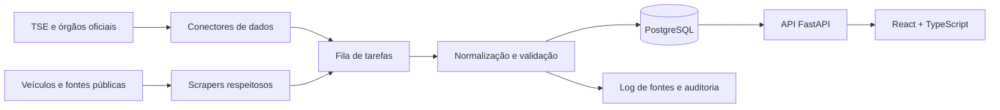

# Pull Info

> **Informação política centralizada, verificável e imparcial.**

O **Pull Info** é uma plataforma em desenvolvimento para reunir, organizar e contextualizar informações públicas sobre eleições, candidatos e propostas.

O projeto foi idealizado durante a disciplina de **Empreendedorismo e Inovação em TIC**, do curso de **Análise e Desenvolvimento de Sistemas da Universidade Federal do Ceará (UFC)**. A proposta surgiu a partir da percepção de que informações políticas importantes estão espalhadas por diferentes fontes, dificultando o acesso, a comparação e a compreensão por parte da população.

Após a elaboração inicial durante a disciplina, surgiu o interesse em continuar o desenvolvimento para além do projeto acadêmico, transformando o Pull Info em uma iniciativa de produto com potencial de evolução e impacto social. A entrega atual da disciplina será um MVP de prototipação navegável desenvolvido no Figma.

> Este repositório está em fase inicial de desenvolvimento. O MVP atual consiste em um protótipo navegável no Figma, criado como entrega da disciplina. A aplicação web, a API, o banco de dados, as integrações e os mecanismos de coleta fazem parte da evolução planejada e ainda não estão implementados.

## Sumário

- [Problema](#problema)
- [Proposta](#proposta)
- [Princípios do projeto](#princípios-do-projeto)
- [Escopo do MVP de prototipação](#escopo-do-mvp-de-prototipação)
- [Stack planejada](#stack-planejada)
- [Arquitetura e fluxo de dados](#arquitetura-e-fluxo-de-dados)
- [Decisões e trade-offs](#decisões-e-trade-offs)
- [Qualidade e transparência dos dados](#qualidade-e-transparência-dos-dados)
- [Roadmap](#roadmap)
- [Como contribuir](#como-contribuir)
- [Licença](#licença)

## Problema

Informações políticas relevantes estão distribuídas entre portais oficiais, bases de dados, veículos de imprensa e outras fontes públicas. Essa fragmentação dificulta a comparação, a consulta e a compreensão do histórico e das propostas de candidatos.

Em períodos eleitorais, o volume de conteúdo aumenta, assim como o risco de informações desatualizadas, sem contexto ou sem indicação clara de origem. O problema não é apenas encontrar informação: é saber **de onde ela veio, quando foi atualizada e como interpretá-la**.

## Proposta

O Pull Info pretende oferecer uma experiência única para:

- centralizar dados públicos sobre candidatos, eleições e propostas;
- priorizar bases oficiais e fontes jornalísticas reconhecidas;
- exibir a origem, a data de coleta e a data da última atualização de cada informação;
- permitir filtros e comparações por eleição, cargo, estado e região;
- apresentar o conteúdo de forma acessível, organizada e compreensível;
- preservar a autonomia do usuário, distinguindo dados, fontes e interpretações.

O objetivo é **informar, não persuadir**. O Pull Info não será uma plataforma de campanha, não apoiará partidos ou coligações e não realizará pesquisas de opinião, enquetes ou recomendações eleitorais.

Além da plataforma, o projeto poderá disponibilizar futuramente uma **API open source** para acesso aos dados públicos coletados e normalizados. Ela poderá ser utilizada por desenvolvedores, pesquisadores, jornalistas, organizações da sociedade civil e outros projetos interessados em construir soluções baseadas em informações eleitorais.

Essa disponibilização dependerá da análise das permissões de cada fonte, dos termos de uso, da aplicação de limites de acesso e do cumprimento da legislação aplicável. Dados que não possam ser redistribuídos não serão expostos diretamente; nesses casos, a API poderá disponibilizar metadados, referências e links para as fontes originais.

## Princípios do projeto

### Neutralidade verificável

A neutralidade não deve depender apenas de uma promessa editorial. As regras de exibição devem ser explícitas, auditáveis e, sempre que possível, implementadas de forma determinística. No produto, a ordenação padrão deverá seguir critérios neutros, como ordem alfabética, cargo ou número oficial, sem destaque baseado em popularidade, engajamento ou preferência política.

### Fontes antes de opiniões

Dados do Tribunal Superior Eleitoral (TSE) e de outros órgãos públicos devem ser a primeira opção. Notícias e análises de veículos reconhecidos podem complementar o contexto, sempre com link para a fonte original e sem substituir o dado oficial.

### Rastreabilidade

Cada registro deve poder responder:

1. qual é a fonte;
2. quando foi publicado ou atualizado na fonte;
3. quando foi coletado pelo Pull Info;
4. se houve transformação, resumo ou validação;
5. qual é o nível de confiança e quais limitações existem.

### Transparência sobre limitações

O produto deve deixar claro quando um dado está ausente, desatualizado, em processamento ou sujeito a revisão. Uma ausência de informação não deve ser apresentada como evidência de ausência de uma candidatura ou proposta.

### Privacidade e responsabilidade

O escopo deve privilegiar informações públicas de interesse eleitoral. Dados pessoais desnecessários, informações sensíveis e conteúdo obtido de forma incompatível com a legislação ou com os termos de uso das fontes não devem ser coletados.

## Escopo do MVP de prototipação

O MVP acadêmico será um protótipo navegável desenvolvido no Figma. Seu objetivo é representar a experiência principal do Pull Info e demonstrar como os usuários poderão consultar informações políticas de forma organizada, clara e imparcial.

### Incluído no protótipo

- tela inicial da plataforma;
- busca por candidatos e eleições;
- filtros por cargo, estado e eleição;
- página de detalhes do candidato;
- apresentação de propostas e informações públicas;
- indicação das fontes e da data de atualização;
- fluxo de navegação responsivo;
- critérios visuais de neutralidade e acessibilidade.

### Não incluído nesta entrega

- recomendação de voto ou classificação ideológica;
- enquetes, pesquisas próprias ou previsão de resultados;
- publicação de conteúdo opinativo;
- aplicação web funcional;
- API, banco de dados e pipeline de ingestão;
- scraping em produção;
- cobertura global;
- validação autônoma por IA sem revisão e sem exibir as fontes.

Definir esse limite permite validar a estrutura e a experiência do produto antes de investir na implementação completa da plataforma.

## Stack planejada

| Camada | Tecnologia | Motivo |
| --- | --- | --- |
| Interface web | React + TypeScript | Componentização, tipagem e ecossistema maduro para interfaces interativas |
| API | FastAPI + Python | Alto desempenho para APIs e integração com coleta, tratamento de dados e IA |
| API pública futura | FastAPI + OpenAPI | Permitir que terceiros consumam dados documentados e controlados |
| Persistência | PostgreSQL | Dados relacionais, filtros, consistência e possibilidade de auditoria |
| Coleta | Python, HTTP client e parsers | Reutilização do ecossistema Python e separação por fonte |
| Tarefas assíncronas | Celery ou RQ + Redis | Execução de coletas sem bloquear as requisições da API |
| Qualidade | Testes unitários, integração e contrato | Proteção contra alterações silenciosas nos dados e na API |
| Mobile (futuro) | React Native | Reaproveitamento de conhecimento e parte da lógica do frontend |

As tecnologias acima são uma direção inicial, não uma obrigação. A escolha definitiva deve considerar volume de dados, custos operacionais, facilidade de manutenção e capacidade da equipe.

## Arquitetura e fluxo de dados

Essa é a arquitetura planejada para uma etapa futura de implementação. O protótipo atual concentra-se na camada de apresentação e nos fluxos de navegação. A aplicação deverá separar **coleta**, **processamento**, **armazenamento** e **apresentação**, permitindo reprocessar dados sem sobrecarregar a interface e tornando mais fácil trocar uma fonte que altere seu formato.

## Decisões e trade-offs

### Dados abertos do TSE versus web scraping

O TSE disponibiliza dados abertos e serviços oficiais que devem ser priorizados por serem mais estruturados e confiáveis. Scraping é útil para complementar informações que não estão disponíveis em formato adequado, mas aumenta a fragilidade do sistema, a necessidade de manutenção e as responsabilidades legais.

**Decisão inicial:** consumir APIs e arquivos oficiais primeiro; usar scraping apenas para fontes necessárias, respeitando `robots.txt`, limites de requisição, termos de uso, atribuição e legislação aplicável.

### Atualização em tempo real versus cache

Consultar fontes a cada acesso deixaria a aplicação lenta, aumentaria custos e poderia provocar bloqueios. Armazenar uma cópia normalizada e atualizá-la em lotes oferece uma experiência mais rápida e previsível, com o custo de um pequeno atraso.

**Decisão inicial:** cache persistente com atualização agendada e indicação visível da última atualização. Informações críticas devem ter atualização mais frequente durante o calendário eleitoral.

### React web versus React Native

Começar pela web reduz o tempo para validar a proposta e facilita o acesso. Planejar um aplicativo nativo desde o início pode acelerar a expansão futura, mas adiciona complexidade de monorepo, publicação e manutenção.

**Decisão inicial:** validar o produto na web, mantendo regras de negócio, tipos e contratos de API independentes da interface para facilitar uma futura versão mobile.

### IA para validação versus viés e alucinação

IA pode ajudar a resumir, detectar divergências e sugerir relações entre fontes, mas não deve ser tratada como autoridade. Modelos podem omitir contexto, reproduzir vieses ou gerar afirmações sem suporte.

**Decisão inicial:** IA como apoio editorial e técnico, sempre com fontes citadas, saída marcada como gerada ou assistida por IA, possibilidade de revisão humana e fallback para o conteúdo original.

### Banco relacional versus banco documental

O domínio possui relações fortes entre eleições, cargos, candidatos, fontes e versões de dados. PostgreSQL favorece consistência, consultas e auditoria. Um banco documental poderia simplificar alguns formatos de coleta, mas transferiria mais validações para a aplicação.

**Decisão inicial:** PostgreSQL na futura implementação web; avaliar armazenamento complementar somente quando houver uma necessidade concreta de escala ou de formatos não estruturados.

## Qualidade e transparência dos dados

Cada fonte deve possuir um conector isolado e um contrato de saída comum. Antes de publicar um registro, o pipeline deverá:

- validar campos obrigatórios e formatos;
- normalizar nomes, datas, cargos e localidades;
- evitar duplicidades;
- preservar o valor bruto quando houver transformação;
- registrar erros, tentativas e horário da coleta;
- detectar divergências entre fontes sem escolher silenciosamente um lado;
- permitir correção ou retirada de conteúdo mediante análise.

Uma possível classificação de origem é:

- **oficial:** publicado por órgão público competente;
- **primária:** publicado diretamente pelo candidato ou instituição responsável;
- **jornalística:** publicado por veículo de imprensa identificado;
- **contextual:** conteúdo auxiliar, sempre acompanhado da fonte e do contexto.

Essa classificação não substitui a leitura crítica: uma fonte oficial pode estar incompleta, e uma fonte jornalística pode trazer contexto que não existe em uma base estruturada.

## Roadmap

### Fase 0 — MVP de prototipação

- criar o protótipo navegável no Figma;
- definir a arquitetura da informação e os principais fluxos de navegação;
- representar busca, filtros, perfil de candidato e fontes;
- documentar critérios visuais de neutralidade, acessibilidade e transparência.

### Fase 1 — Implementação web

- implementar a aplicação web com React e TypeScript;
- criar a API mínima com FastAPI e Python;
- definir o modelo de dados e a persistência;
- cobrir até três estados;
- exibir candidaturas e dados oficiais;
- implementar busca, filtros, fontes e data de atualização;
- criar testes para os principais fluxos.

### Fase 2 — Contexto e cobertura

- incorporar propostas e notícias de fontes selecionadas;
- adicionar comparação por estado e região;
- melhorar histórico de alterações e tratamento de conflitos;
- avaliar a disponibilização de uma API open source para consumo dos dados públicos coletados, normalizados e devidamente referenciados;
- ampliar gradualmente a cobertura após validar qualidade e operação.

### Fase 3 — Mobile e acessibilidade

- avaliar React Native com base no uso real da web;
- adicionar notificações de atualizações relevantes;
- aprimorar acessibilidade, desempenho e suporte a conexões lentas.

### Fase 4 — Assistência por IA e expansão

- sumarização com citação e revisão;
- detecção assistida de inconsistências;
- suporte a eleições de outros países, observando legislação, idioma e contexto local;
- análise comparativa internacional sem transformar o produto em uma plataforma de opinião.

## Métricas de sucesso

Além de métricas de tráfego, o projeto deve acompanhar indicadores de confiança e utilidade:

- percentual de registros com fonte e data de atualização;
- tempo necessário para encontrar uma informação;
- taxa de falha e de atualização dos conectores;
- quantidade de conflitos detectados e resolvidos;
- feedback sobre clareza e percepção de neutralidade;
- acessibilidade e desempenho da interface.

Não utilizar cliques ou tempo de permanência como justificativa para promover um candidato ou uma posição política.

## Como contribuir

Contribuições são bem-vindas, especialmente em:

- conectores para fontes públicas;
- modelagem e qualidade de dados;
- acessibilidade e experiência do usuário;
- testes automatizados;
- documentação e revisão de critérios de neutralidade.

Antes de propor uma alteração, descreva o problema, a fonte afetada e o impacto esperado. Mudanças que alterem ordenação, destaque, classificação ou sumarização devem explicar como preservam a neutralidade e a rastreabilidade.

## Licença

Este projeto ainda não possui uma licença definida. A licença deve ser escolhida antes da publicação de contribuições externas, considerando o código, a documentação e as restrições de uso dos dados coletados.
